# Foundation: Document and Custom Mapping

**Scope: PR 1 only.** Follow-on PRs are listed at the end for context, not as part of this design.

**Application chooses the object mapping. Multicloud validates and maps the data. Native SDK sends it.**

## 1. What is Document?

An **immutable, typed object**, not JSON text or bytes. It supports null, boolean, string, number, array, and object. Missing fields differ from explicit null.

**Class structure** (simplified; constructors, validation, and other methods omitted):

```java
public final class Document {
    private final ObjectValue root;
    public ObjectValue root() { return root; }
}

public final class ObjectValue implements DocumentValue {
    private final Map<String, DocumentValue> fields;
    public Map<String, DocumentValue> fields() { return fields; }
}

public sealed interface DocumentValue permits
        NullValue, BooleanValue, StringValue,
        NumberValue, ArrayValue, ObjectValue {}
```

**Example instance**

```java
Document document = Document.builder()
        .put("product_name", new StringValue("Book"))
        .put("quantity", NumberValue.of(2))
        .put("shipping", ObjectValue.of(Map.of(
                "city", new StringValue("Seoul"))))
        .build();
```

## 2. How does custom mapping work?

Use the supplied **JacksonDocumentCodec** with application-configured naming, modules, and serializers, or implement **DocumentCodec** with another mapper.

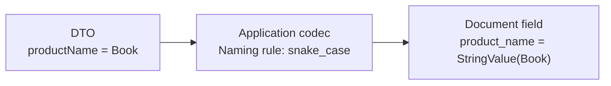

```java
Document document = codec.encode(order, Order.class);
Order restored = codec.decode(document, Order.class);
```

The Jackson adapter uses in-memory tokens, not a JSON byte serialization/reparse cycle. Custom mapping controls business fields; **database keys and native types remain SDK-owned**.

## 3. End-to-end workflow

**Write: application to database**

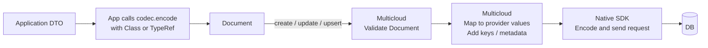

**Read: database to application**

The app calls `read(address, key)`. A found item's data returns through:

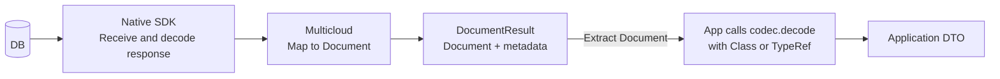

The app invokes the codec explicitly. A missing read returns no document; handle it before decoding.

## 4. Provider-specific data flow

Each write below starts after Document-level validation.

### Cosmos DB

**Write**

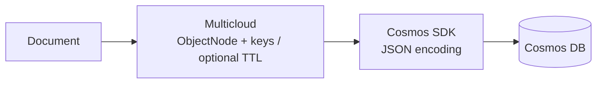

**Read**

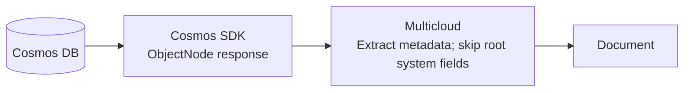

### DynamoDB

**Write**

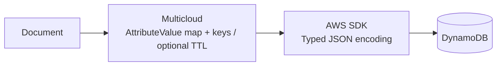

**Read**

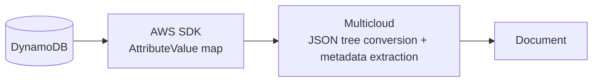

### Spanner

**Write**

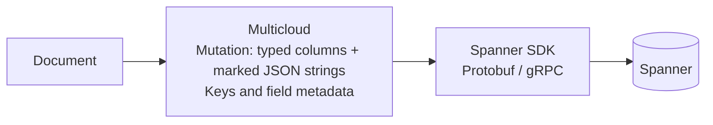

**Read**

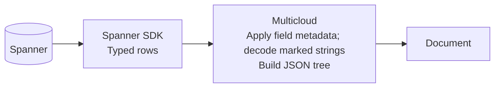

### Native input example

The same `quantity: 2` field becomes:

| Provider | Multicloud constructs | Native SDK encodes |
|---|---|---|
| **Cosmos** | ObjectNode containing `{"quantity": 2}` | JSON request |
| **DynamoDB** | AttributeValue: `N = "2"` | Typed DynamoDB JSON request |
| **Spanner** | Mutation binding: `quantity = INT64(2)` | Protobuf / gRPC request |

These are selected-field sketches; the SDK also supplies keys and metadata. ObjectNode is our Cosmos adapter's choice, not a Cosmos requirement. Spanner nested objects use marked JSON strings in compatible columns.

## 5. Size and value guarantees

**Check what is known from Document before building provider input.**

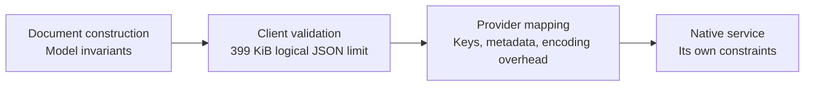

| Boundary | What it establishes |
|---|---|
| **Document** | Immutable values; valid root/types/depth/model number bounds; missing differs from null |
| **Logical size** | At most **399 KiB = 408,576 bytes**, counted without creating JSON bytes |
| **Provider and service** | Native schema, type, and size constraints; passing the logical check does **not** guarantee native fit |

DynamoDB's native item limit is **400 KiB**; Cosmos and Spanner have different limits and accounting rules. Model number support/equality does not guarantee identical database precision, scale, or arithmetic.

**Not guaranteed by PR 1:** comprehensive native-size prechecks, an expanded portable numeric domain, or a common final-document limit after partial updates. An update's input size is not its resulting document size.

## 6. Delivery plan

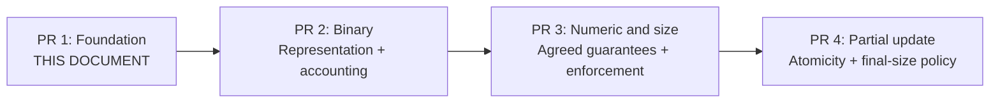

**PR 1:** Document, custom codecs, optional Jackson, validation, and provider integration. Each PR includes its own tests, documentation, and changelogs.

Future review: PR 2 - Binary, PR 3 - Numeric and Size, PR 4 - Partial Update. These contracts require separate agreement.

*Design summary, not a released-support guarantee.*
