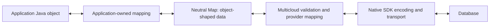

# Foundation: Map Boundary and Application-Owned Mapping

**Draft. Scope: this PR only.** Use a Map boundary and application-owned mapping.
The contracts below are agreed. Dependency validation targets current Cosmos v4.

**The application maps Java objects. Multicloud validates and maps neutral data.
The native SDK owns transport encoding.**

## 1. Principles and flow

- Use `Map<String, Object>` for object-shaped public inputs and results where
  needed.
- Applications explicitly map Java objects using their chosen library or
  handwritten code. Multicloud does not discover arbitrary POJOs or automatically
  invoke application serializers.
- Provide application mapping examples, not a shipped mapping interface or codec
  hierarchy. Any Jackson example is
  sample-only, with dependencies separate from shipped SDK modules.
- Multicloud production code must not use Jackson, and its POMs must not declare
  an explicit Jackson dependency or introduce one through a shipped codec.
  Package the Cosmos SDK and its required private runtime dependencies inside
  the Cosmos provider; keep the shared dependencies described below external.
- Keep public contracts neutral: no native Azure/Cosmos types in public APIs.
- Validate after application mapping and before provider delegation. Avoid
  redundant conversions in Multicloud, without promising zero-copy behavior.
- Finalize a stable public contract in this release, with explicit migration
  guidance and supported-value behavior.

Queries retain their existing Map-row contract, including nested scalar/array
values and existing unsupported-result errors. Feed data may be a neutral
object, array, scalar or explicit null; payload presence is separate.

## 2. Provider responsibilities

| Provider | Multicloud mapping | Encoding that remains |
|---|---|---|
| Cosmos | Pass detached Maps to native create/upsert/replace calls; request object point reads with `Map.class`. | Native Cosmos encoding and conversions; retain decimal normalization, metadata and root system-field filtering. |
| DynamoDB | Convert supported Map values to native AttributeValue containers and native results to the agreed neutral shapes. | Native request encoding; preserve existing numeric text and read-conversion behavior. |
| Spanner | Convert values to typed mutations/rows, retaining FIELD_DATA and marked nested JSON STRINGs. | Native Protobuf/gRPC plus JSON encoding/parsing required by persisted strings and metadata. |

Remove direct Jackson usage across affected writes, reads, queries, feeds and
internal persisted JSON. Preserve existing formats and satisfy the dependency
rules below.

## 3. Public contracts

`Map<String, Object>` does not mean arbitrary Java objects. Values are string-keyed
nested Maps, ordered Lists, Strings, Booleans, null and the numbers below.
Missing keys differ from present nulls.

| Surface | Contract |
|---|---|
| Public API surface | Map-based create/update/upsert inputs; retain `DocumentResult` with a `Map<String, Object>` payload and optional metadata. A missing point read still returns null. No shipped mapping interface, `TypeRef` or codec hierarchy. |
| Numbers and bounds | Accept exactly Byte, Short, Integer, Long, Float, Double, BigInteger and BigDecimal; floating-point values must be finite. Preserve released numeric/depth behavior within this vocabulary, without new precision/scale/depth caps or claims of identical database round trips. |
| Container validation | Accept Maps and Lists; reject cycles, non-string/null keys, arrays, sets, arbitrary POJOs and other Number implementations before native I/O with `INVALID_REQUEST`. Shared acyclic subtrees are valid. Errors must not expose payloads; closed-client checks remain first. |
| Input ownership | Callers must not mutate input or nested containers during the entire synchronous write call. The SDK must not mutate caller data or retain it after return; make necessary provider copies, not universal recursive snapshots. |
| Output ownership | Point-read/feed Maps and Lists are detached and mutable. `QueryPage` retains an unmodifiable list and top-level row Maps with nested mutability; this is not deep immutability. |
| Query shapes | Retain `QueryPage.items(): List<Map<String, Object>>`, nested scalar/array values and existing supported shapes/errors. No generalized top-level scalar/array query API. |
| Feed presence | `ChangeEvent.data(): Object` carries neutral data; `hasData()` distinguishes absence from explicit null. The five-argument constructor treats null as absent; a six-argument constructor specifies presence. Absent data must be null; present data may be null or another supported value. Empty objects remain present. |

Document migration against the released SDK version customers actually use.

## 4. Dependencies

Separate source/build dependencies from the published consumer dependency graph.
The Cosmos provider uses provider-local shading and relocation, not missing
runtime dependencies disguised by Maven exclusions.

- Remove Jackson imports, explicit dependencies and Jackson version declarations
  from Multicloud-owned production code and POMs, including the root POM.
  Do not reintroduce it through a shipped codec or wrapper.
- The Cosmos provider declares its required native SDK dependencies, including
  `azure-cosmos` and `azure-identity`, and passes ordinary Maps. Bundle and
  relocate their required private runtime closure, including Jackson, Netty,
  Reactor and Azure authentication implementation dependencies.
- Keep `multiclouddb-api` and SLF4J external and unrelocated.
  JNA (Java Native Access)/`jna-platform` remains shared and unrelocated:
  ordinary Java package relocation breaks `jnidispatch` JNI bindings.
  The tested v4 configuration uses JNA 5.13.0 and `jna-platform` 5.17.0.
  Both provider and application use the shared classes; arbitrary application
  JNA-version coexistence is not established. This is not full runtime isolation
  or a version-enforcement policy. Do not infer that JNA and `jna-platform` must
  have identical version numbers.
- Publish a dependency-reduced POM that retains those external dependencies
  without exposing the bundled native SDK closure as consumer dependency edges.
  Native dependencies still belong in the provider's source/build graph.
- Applications include only the provider dependencies they need. Including the
  Cosmos provider includes its bundled runtime and remaining external
  dependencies even if another provider is selected at runtime; this is not
  runtime dependency loading.
- The API, DynamoDB and Spanner modules must not depend on the Cosmos provider
  merely to reuse mappings. Verify their resolved dependency graphs before
  claiming they receive no Jackson from any source.
- Relocate Netty packages together with matching native-library resource
  filenames. Merge/transform service registrations and namespace private
  metadata lookups; preserve multi-release class paths and license notices.
- Preserve explicit Java Platform Module System (JPMS) support, the
  `com.multiclouddb.provider.cosmos` module name and its no-public-exports boundary.
  Do not blindly copy dependency exclusions, JAR minimization or module-descriptor
  stripping from another package.
- Multicloud code must not use Jackson just because it is available transitively.

Gson is permitted only for necessary internal cursor/persisted-data JSON syntax
processing, with legacy number and escaping behavior preserved. It must not map
application POJOs or introduce a public serializer API. Verify resolved dependency
graphs and runtime operation for each provider.

The earlier packaging prototype validated the pre-refactor v4 implementation.
The source-integrated Map artifact now has local install/deploy/clean-consumer
evidence, Windows/Linux classpath/module-path collision checks, native TLS/JNA,
Linux epoll and synthetic loopback HTTP/2 checks. These do not establish live
cloud authentication or arbitrary application/infrastructure compatibility.

## 5. Behavior preserved by this PR

Preserve native numeric text/types, existing conversion limitations, persisted
formats, keys, TTL, conditions, metadata, field visibility, errors and transaction/
native call counts. In particular, retain Spanner's marked nested JSON strings,
FIELD_DATA and existing update behavior. Replacing a serializer does not authorize
numeric fixes or schema migration.

Retain the **399 KiB (408,576-byte) logical JSON input check** for create/update/
upsert, including its numeric and surrogate-escaping profile. Validate equivalent
behavior rather than assuming replacement encoders produce identical bytes.
This is not native item accounting, guaranteed native fit, or the final size
after an update.

## 6. Reviewability and acceptance

Minimize the final diff against the **actual PR target base**. Reuse existing Map
APIs/helpers and keep only changes needed for this design. Avoid unrelated
edits and formatting changes; retain required tests and directly affected docs.

- [x] Integrate provider-local packaging with the production flatten/shade/
  install/deploy lifecycle. Verify that a clean consumer resolves the actual
  published POM/JAR with the intended bundled and external dependencies.
- [x] Verify clean and conflicting-application classpaths and explicit module
  paths, provider discovery, shared API/logging/JNA identity and encapsulation.
- [x] Verify Windows/Linux native TLS and HTTP/2, Linux epoll, and private
  service/metadata/native-resource isolation against application dependencies.
  Repeat these checks when the packaged dependency configuration changes.
- [x] Verify restricted internal Gson usage and each provider's resolved graph and
  required runtime libraries; Cosmos packaging must not add dependencies to peers.
- [x] Implement the agreed write/read/result, value, ownership and query/feed
  contracts without a shipped mapping interface; document migration from the
  customer's actual released baseline.
- [x] Demonstrate explicit application-owned mapping with sample dependencies
  separate from shipped SDK modules.
- [x] Verify Cosmos Map writes/object reads and removal of direct Jackson usage
  from all affected Multicloud paths without a covert serializer replacement.
- [x] Compare native requests/results and persisted JSON with existing behavior,
  including numbers, Unicode, size boundaries, keys/TTL and metadata.
- [x] Cover mutation isolation, invalid/cyclic/shared inputs and non-object
  results according to the agreed contracts.
- [x] Verify representative migrated customer CRUD/query/feed/mapping examples
  against this PR, including returned Java types, null/metadata and ownership.
- [x] Review the target-base diff for justified files/lines, retaining tests and
  directly affected migration guidance.
